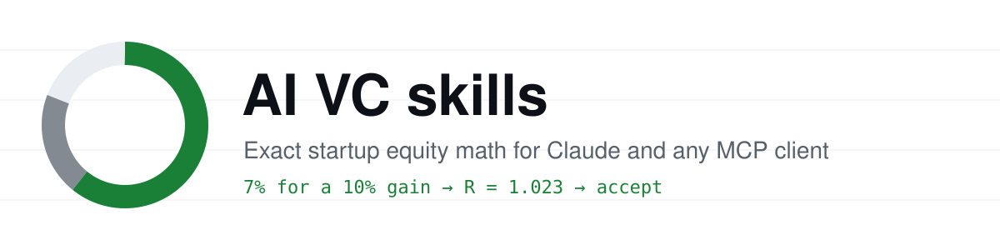

<p align="center">
  <picture>
    <source media="(prefers-color-scheme: dark)" srcset="assets/banner-dark.svg">
    
  </picture>
</p>

<p align="center">
  <a href="https://github.com/BwL1289/ai-vc-skills/actions/workflows/ci.yml"></a>
  <a href="LICENSE"></a>
  <a href="#skills"></a>
  <a href="#install"></a>
  <a href="docs/install.md"></a>
  
</p>

<p align="center">
  <b>Ask your AI the equity questions founders get wrong, and get exact answers you can check by hand.</b>
</p>

<p align="center">
  <a href="#install">Install</a> ·
  <a href="#skills">Skills</a> ·
  <a href="#what-you-can-ask">What you can ask</a> ·
  <a href="#how-it-works">How it works</a> ·
  <a href="#roadmap">Roadmap</a> ·
  <a href="CONTRIBUTING.md">Contributing</a>
</p>

<p align="center">
  
</p>

**AI VC skills** are agent skills for the money side of building a startup: the questions you face when an investor
wants a stake, a hire wants a grant, or a round converts your SAFEs. Each skill tells the agent when to act and how;
the numbers come from an exact calculator, never from the model's own arithmetic, and every answer shows its formula,
its source and its assumptions.

Works with Claude Code (as a plugin), Claude Desktop, Cursor and any client that speaks
[MCP](https://modelcontextprotocol.io) or reads [Agent Skills](https://agentskills.io).

## Install

**Claude Code** (recommended):

```
/plugin marketplace add BwL1289/ai-vc-skills
/plugin install ai-vc-skills@ai-vc-skills
```

That adds every skill and the calculator's MCP server, which starts with [`uv`](https://docs.astral.sh/uv/)'s `uvx`
(install uv first). Ask your first question in a new session.

<details>
<summary><b>Claude Desktop, Cursor and other MCP clients</b></summary>

```
pip install "equity_calculator[mcp] @ git+https://github.com/BwL1289/ai-vc-skills#subdirectory=equity_calculator"
```

```json
{
  "mcpServers": {
    "equity_calculator": { "command": "equity_calculator_mcp" }
  }
}
```

Add the server to the client's MCP settings, then load `skills/equity-calculator/`, `skills/vc-deal-math/` and
`skills/vc-positioning/` where the client reads skills.
Step by step for each client: [docs/install.md](docs/install.md).

</details>

<details>
<summary><b>Command line and Python</b></summary>

```
pip install "equity_calculator @ git+https://github.com/BwL1289/ai-vc-skills#subdirectory=equity_calculator"
equity_calculator investor --equity-percent 7 --outcome-multiplier 1.10
```

```python
from decimal import Decimal

from equity_calculator.scenarios import compute
from equity_calculator.schemas.equity import InvestorInput

result = compute(InvestorInput(equity_percent=Decimal("7"), outcome_multiplier=Decimal("1.10")))
print(result.verdict, result.value_ratio.exact)  # accept 1023/1000
```

</details>

## Skills

| Skill                                                    | What it does                                                                                                                                                                                                                            | Status       |
| -------------------------------------------------------- | --------------------------------------------------------------------------------------------------------------------------------------------------------------------------------------------------------------------------------------- | ------------ |
| [`equity-calculator`](skills/equity-calculator/SKILL.md) | Eight equity scenarios worked exactly: the investor test, a hire's grant, the option-pool shuffle, SAFEs and notes in a priced round, dilution, vesting, exit waterfalls, and a check of a raise's numbers.                             | ✅ Available |
| [`vc-deal-math`](skills/vc-deal-math/SKILL.md)           | For founders: checks your own deck's ask before a VC does (valuation, ownership after the round, the pool top-up, the SAFE stack, runway, use of funds), every number from the calculator.                                              | 🧪 Preview   |
| [`vc-positioning`](skills/vc-positioning/SKILL.md)       | For founders: tightens your raise's messaging before you go out, with an adversarial review (skeptical lenses attack it, your own material defends it), a say-and-avoid list and a prep script for a session with an existing investor. | 🧪 Preview   |
| More venture-style reviews                               | Pitch decks, term sheets and due-diligence questions: see your raise the way a VC will.                                                                                                                                                 | 🗺️ Planned   |

`vc-deal-math` and `vc-positioning` are in preview until they have been checked on real decks; the arithmetic is
tested, the wording may change.

The `equity-calculator` skill covers eight scenarios:

| Scenario     | The question it answers                                                                                      |
| ------------ | ------------------------------------------------------------------------------------------------------------ |
| `investor`   | An investor wants n of the company. Is the deal worth it? (Paul Graham's equity equation)                    |
| `employee`   | How much of the company is a hire worth at most, and what would Paul Graham's rule of thumb offer?           |
| `pool`       | A round asks for a bigger option pool. What is the real price per share, and who owns what afterwards?       |
| `round`      | A priced round converts post-money SAFEs and convertible notes. At what price, and who owns what afterwards? |
| `dilution`   | A holder owns h of the company. What is left after a series of rounds?                                       |
| `vesting`    | How much of a grant has vested at a given month, and what is it worth above the strike?                      |
| `waterfall`  | The company is sold. Who gets what, with preferences paid by rank and each preferred class free to convert?  |
| `deal_check` | Do a raise's valuation, percent sold, ownership after the round and runway agree, as a VC will check them?   |

## What you can ask

Once the plugin is installed, ask in plain words:

> An investor wants 7% and says the deal makes the company 10% more valuable. Should we take it?

> We have 10M shares, a $1M post-money SAFE capped at $8M, and we're raising $3M at $12M pre with the pool topped up
> to 10%. What does the SAFE convert at, and who owns what?

> How much equity is a hire worth if they make the company 25% more valuable?

> The Series A sells 20% and adds a 10% pool. What's left of my 30%?

> We sell for $50M. The investors put in $10M for 25% of the shares, with a 1x non-participating preference. Who gets
> what?

> How much of a 4-year grant with a 1-year cliff has vested at month 30?

> Check my deck's numbers: we're raising $3M at $12M pre for 20%, with a 10% pool in the pre-money, and the deck says
> 24 months of runway. We have 8M shares, $400k in the bank, and plan to burn $180k a month.

## How it works

```
  You ask                          The skill                         The MCP server
 ┌───────────────────────┐       ┌──────────────────────────┐       ┌─────────────────────────────┐
 │ "Should we sell 7%    │ ────▶ │ equity-calculator        │ ────▶ │ equity_calculator           │
 │  for a 10% gain?"     │       │ picks the scenario:      │       │ works it in exact fractions │
 │                       │       │ the investor test        │       │ R = (1 - n)·m = 1023/1000   │
 └───────────────────────┘       └──────────────────────────┘       └──────────────┬──────────────┘
                                                                                   │
                ┌──────────────────────────────────────────────────────────────────┘
                ▼
   "Accept. The holders keep 1.023x what the whole company was worth before.
    Selling 7% breaks even at a 7.53% gain."  + the formula, its source and every assumption
```

- **Exact.** Every number is a fraction, rounded once for display (one marked exception: a note's interest over a part
  period). No floating point inside a result.
- **Checkable.** Each line of a result says how it was computed; each result lists the assumptions it rests on and
  their sources (Paul Graham, Sam Altman, Y Combinator's SAFE documents), and marks the rest `unverified`.
- **Four ways to run it.** The MCP server for agents, a command, an `.xlsx` workbook whose investor verdict re-works
  when you change a cell (`--xlsx deal.xlsx`), and a Python package.
- **Local.** The server runs on your machine and makes no network calls ([SECURITY.md](SECURITY.md)).

<p align="center">
  
</p>

The formulas, their sources, every flag and a worked example per scenario are in the
[equity calculator's guide](equity_calculator/README.md).

## Roadmap

- [x] `equity-calculator`: eight scenarios, command, workbook, MCP server, Python package
- [x] Claude Code plugin and marketplace
- [ ] `vc-deal-math`: founders check their own deck's numbers with the calculator (preview)
- [ ] `vc-positioning`: founders tighten their raise's messaging, stress-tested by an adversarial review, and prep it
      with an existing investor (preview)
- [ ] A pitch-deck review: how a VC is likely to read your deck (pass, too early, take the meeting) and what to change
- [ ] A term-sheet review, clause by clause, with the exit waterfall computed
- [ ] The due-diligence questions a VC is likely to ask, ranked by how much each answer moves their decision, so you
      can prepare

Want a skill that is not here? [Request it](https://github.com/BwL1289/ai-vc-skills/issues/new?template=skill_request.yml).

## Project structure

| Path                                       | What it is                                                                                       |
| ------------------------------------------ | ------------------------------------------------------------------------------------------------ |
| [`skills/`](skills/)                       | One folder per agent skill, each with its `SKILL.md`.                                            |
| [`equity_calculator/`](equity_calculator/) | The calculator: a Python package with the command, the workbook, the MCP server and tests.       |
| [`.claude-plugin/`](.claude-plugin/)       | `marketplace.json` and `plugin.json`: the Claude Code marketplace and its one plugin.            |
| [`evals/`](evals/)                         | Test prompts per skill, each with the expected tool call and an answer pasted from real output.  |
| [`template/`](template/)                   | The starting point for a new skill.                                                              |
| [`scripts/`](scripts/)                     | `validate_skills.py`, which checks every skill in CI.                                            |
| [`docs/`](docs/)                           | [Install guide per client](docs/install.md) and [how to write a skill](docs/writing-a-skill.md). |
| [`AGENTS.md`](AGENTS.md)                   | Instructions for AI coding agents working on this repository.                                    |

## Contributing

New skills, fixes to the math and clearer docs are welcome; a wrong number is the most important bug to report. See
[CONTRIBUTING.md](CONTRIBUTING.md) to add a skill from the template and run the checks, and
[CHANGELOG.md](CHANGELOG.md) for what changed.

<details>
<summary><b>Names: why most use underscores and two keep hyphens</b></summary>

Every name uses underscores, the repository's style: the folder `equity_calculator/`, the pip package
`equity_calculator`, the commands `equity_calculator` and `equity_calculator_mcp`, and the MCP server name
`equity_calculator`. Two things keep hyphens: skill names, such as `equity-calculator` (the Agent Skills format allows
only lowercase letters, digits and hyphens, and the folder must carry the same name), and command-line flags, such as
`--equity-percent`.

The first version used hyphens (`equity-calculator`, `equity-calculator-mcp`). If you installed it, remove it and its
MCP server first, then install again with the lines above:

```
pip uninstall equity-calculator
claude mcp remove equity-calculator
```

The repository was called `opensource-content` until November 2026; GitHub redirects the old address.

</details>

## History

The repository started in October 2024 with a 284-line script that worked Paul Graham's investor test for two real
decisions at Eugo: an offer for a share of the company and a hire's grant. In November 2026 it became the exact
equity calculator, then the first of the AI VC skills. The original script is at
[`src/equity_equation/` in commit 8748071](https://github.com/BwL1289/ai-vc-skills/tree/87480719db0871c6b467a16437919d1df84055ed/src/equity_equation).

## License and credits

MIT, see [LICENSE](LICENSE). The calculator implements:

- Paul Graham, ["The Equity Equation"](https://paulgraham.com/equity.html), July 2007: the investor and employee
  tests, the salary rule of thumb and the dilution step.
- Sam Altman, ["Employee Equity"](https://blog.samaltman.com/employee-equity), April 2014: grants measured against the
  fully diluted shares, and the 4-year schedule with a 1-year cliff.
- Y Combinator's post-money SAFE forms and its Post-Money Safe User Guide,
  [ycombinator.com/documents](https://www.ycombinator.com/documents): the SAFE conversion rules.

Everything else (option pools, notes, preferred stock, the finer vesting terms) is standard arithmetic, marked
`unverified` in each result's assumptions. This is a calculator, not investment, legal or tax advice.
