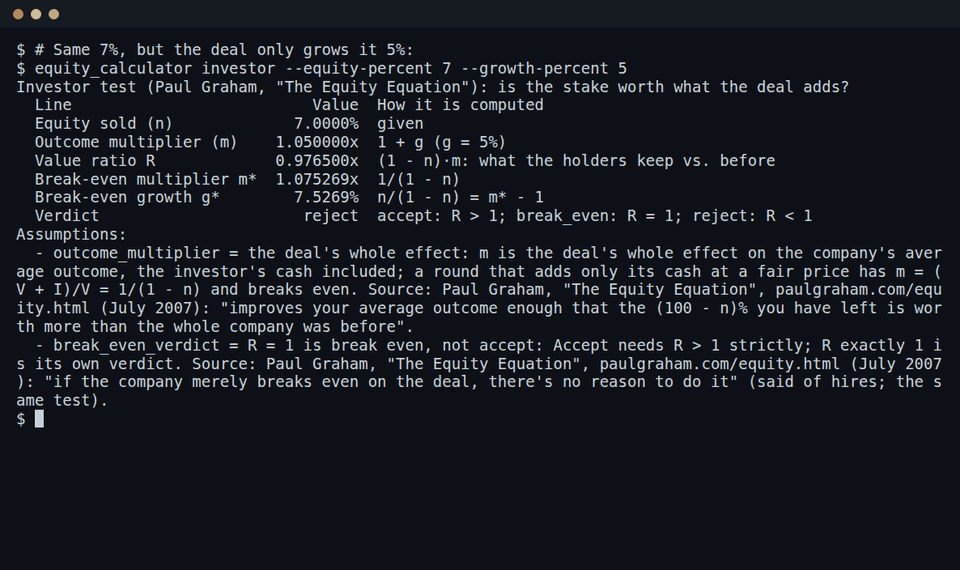

<p align="center">
  <picture>
    <source media="(prefers-color-scheme: dark)" srcset="assets/banner-dark.svg">
    
  </picture>
</p>

<p align="center">
  <a href="https://github.com/BwL1289/ai-vc-skills/actions/workflows/ci.yml"></a>
  <a href="LICENSE"></a>
  <a href="#skills"></a>
  <a href="#install"></a>
  <a href="docs/install.md"></a>
  
</p>

<p align="center">
  <b>Get your raise ready before a VC sees it: skeptical reviews of your deck, claims, metrics, round and term sheet, and exact equity math you can check by hand.</b>
</p>

<p align="center">
  <a href="https://bwl1289.github.io/ai-vc-skills/">Website</a> ·
  <a href="#install">Install</a> ·
  <a href="#skills">Skills</a> ·
  <a href="#what-you-can-ask">What you can ask</a> ·
  <a href="#how-it-works">How it works</a> ·
  <a href="#roadmap">Roadmap</a> ·
  <a href="CONTRIBUTING.md">Contributing</a>
</p>

<p align="center">
  
</p>

<p align="center">
  <sub>A real run. The prompt asks for five short lines, so the answer shortens the calculator's figures.</sub>
</p>

**AI VC skills** are agent skills that help a founder get a raise ready before a VC sees it. They check your deck's
ask and its claims, review your deck, messaging, metrics, market size, round size, term sheet and investor updates,
show the judgment behind what you built, build your competition map, plan your raise from your own investor list, draft
the emails that open investor conversations, learn from the passes you get, size the option pool your hiring plan
needs, rehearse your partner meeting, prepare you for diligence and draft the memo your champion partner is likely to
write. In every review, skeptical passes raise the strongest objections to your
material, then a refute pass drops each one that your own material answers or that rests on a fact you did not give.
What is left is what you still need to fix, answer or take to your lawyer.

Every figure about your company comes from an exact calculator or from your own material, never from the model's own
arithmetic. The calculator's report says how each line was computed, and each result lists its assumptions and their
sources. The same calculator answers the equity questions founders get wrong (an investor's stake, a hire's grant,
SAFEs converting in a round) in figures you can check by hand. An investor's view is only a lens the reviews apply:
the skills never screen deals and never speak as a named investor or firm.

Works with Claude Code (as a plugin), Claude Desktop, Cursor and any client that speaks
[MCP](https://modelcontextprotocol.io) or reads [Agent Skills](https://agentskills.io).

## Install

**Claude Code** (recommended):

```
/plugin marketplace add BwL1289/ai-vc-skills
/plugin install ai-vc-skills@ai-vc-skills
```

That adds every skill and the calculator's MCP server, which starts with [`uv`](https://docs.astral.sh/uv/)'s `uvx`
(install uv first). Ask your first question in a new session.

<details>
<summary><b>Claude Desktop, Cursor and other MCP clients</b></summary>

```
pip install "equity_calculator[mcp] @ git+https://github.com/BwL1289/ai-vc-skills#subdirectory=equity_calculator"
```

```json
{
  "mcpServers": {
    "equity_calculator": { "command": "equity_calculator_mcp" }
  }
}
```

Add the server to the client's MCP settings, then load `skills/equity-calculator/`, `skills/vc-deal-math/`,
`skills/vc-positioning/`, `skills/vc-claims-check/`, `skills/vc-deck-review/`, `skills/vc-partner-meeting/`, `skills/vc-taste-check/`, `skills/vc-round-sizing/`, `skills/vc-term-sheet-review/`, `skills/vc-diligence-questions/`, `skills/vc-current-investor-update/`, `skills/vc-metrics-readiness/`, `skills/vc-investor-memo/`, `skills/vc-market-sizing/`, `skills/vc-prospective-investor-update/`, `skills/vc-competitive-landscape/`, `skills/vc-raise-plan/`, `skills/vc-intro-email/`, `skills/vc-pass-debrief/` and `skills/vc-option-pool-plan/` where the client reads skills.
`vc-diligence-questions` reads `vc-partner-meeting`'s question bank, so load both folders.
`vc-prospective-investor-update` reads `vc-current-investor-update`'s metric rules file, so load both folders.
Step by step for each client: [docs/install.md](docs/install.md).

</details>

<details>
<summary><b>Command line and Python</b></summary>

```
pip install "equity_calculator @ git+https://github.com/BwL1289/ai-vc-skills#subdirectory=equity_calculator"
equity_calculator investor --equity-percent 7 --outcome-multiplier 1.10
```

```python
from decimal import Decimal

from equity_calculator.scenarios import compute
from equity_calculator.schemas.equity import InvestorInput

result = compute(InvestorInput(equity_percent=Decimal("7"), outcome_multiplier=Decimal("1.10")))
print(result.verdict, result.value_ratio.exact)  # accept 1023/1000
```

</details>

## Skills

| Skill                                                                              | What it does                                                                                                                                                                                                                                                                                                                                                                                                                                                                                          | Status       |
| ---------------------------------------------------------------------------------- | ----------------------------------------------------------------------------------------------------------------------------------------------------------------------------------------------------------------------------------------------------------------------------------------------------------------------------------------------------------------------------------------------------------------------------------------------------------------------------------------------------- | ------------ |
| [`equity-calculator`](skills/equity-calculator/SKILL.md)                           | Fourteen equity scenarios worked exactly: the investor test, a hire's grant, the option-pool shuffle, SAFEs and notes in a priced round, dilution, vesting, exit waterfalls, a check of a raise's numbers, how long a raise lasts on a plan, a check of traction metrics, a market size built bottom-up, a priced round now set beside a convertible note now, the pool a hiring plan needs beside a term sheet's ask, and what is left of a round with the term sheets a funnel is expected to give. | ✅ Available |
| [`vc-deal-math`](skills/vc-deal-math/SKILL.md)                                     | For founders: checks your own deck's ask before a VC does (valuation, ownership after the round, the pool top-up, the SAFE stack, runway, use of funds), every number from the calculator.                                                                                                                                                                                                                                                                                                            | 🧪 Preview   |
| [`vc-positioning`](skills/vc-positioning/SKILL.md)                                 | For founders: tightens your raise's messaging before you go out, with an adversarial review (skeptical lenses attack it, then a judge drops what your own material already answers), a say-and-avoid list and a prep script for a session with an existing investor.                                                                                                                                                                                                                                  | 🧪 Preview   |
| [`vc-claims-check`](skills/vc-claims-check/SKILL.md)                               | For founders: checks every claim in your deck, one-pager and narrative before a VC does (a source you can show, figures that agree, patterns a VC discounts), with a skeptic that picks what a partner checks first and a refute pass that keeps only grounded attacks.                                                                                                                                                                                                                               | 🧪 Preview   |
| [`vc-deck-review`](skills/vc-deck-review/SKILL.md)                                 | For founders: reads your deck the way a partner will before the meeting: ten dimensions marked by the evidence the deck shows, first- and last-slide rules, competition at four levels, a ranked fix list from an adversarial review, and which kind of investor the story fits. No score, no named firms.                                                                                                                                                                                            | ✅ Available |
| [`vc-partner-meeting`](skills/vc-partner-meeting/SKILL.md)                         | For founders: rehearses a partner meeting: the hardest questions your own material leaves open, asked one at a time or in one message, prep for what a partner checks around the meeting, and a debrief with a stronger answer per weak one, built only from what you said.                                                                                                                                                                                                                           | 🧪 Preview   |
| [`vc-taste-check`](skills/vc-taste-check/SKILL.md)                                 | For founders: shows the judgment behind what you built (your product, brand and scope decisions and what you said no to), flags choices that read as generic, AI-sounding, copied or polished over, runs the same attack-and-refute review, and turns what survives into why-we-built-it-this-way lines for the deck and the meeting.                                                                                                                                                                 | 🧪 Preview   |
| [`vc-round-sizing`](skills/vc-round-sizing/SKILL.md)                               | For founders: sizes your raise on your own plan: how long each amount lasts on plan and in a downside, which milestone month its cash reaches with time to raise the next round, the smallest raise that gets there, and raise-now against wait side by side, every number from the calculator or from your own plan.                                                                                                                                                                                 | 🧪 Preview   |
| [`vc-term-sheet-review`](skills/vc-term-sheet-review/SKILL.md)                     | For founders: reads a term sheet you were offered in plain words, marks each term against YC's standard and clean Series A term sheet, runs the round and an exit waterfall at low and high exits on the calculator, and ends with questions for your lawyer. Never says whether to sign.                                                                                                                                                                                                             | 🧪 Preview   |
| [`vc-diligence-questions`](skills/vc-diligence-questions/SKILL.md)                 | For founders: prepares you for a fund's due diligence after the first meeting: the questions your own material leaves open, by area, ranked by how much each answer moves the decision, with draft answers from your own material and a data-room checklist scaled to your stage.                                                                                                                                                                                                                     | 🧪 Preview   |
| [`vc-current-investor-update`](skills/vc-current-investor-update/SKILL.md)         | For founders: writes or reviews your monthly or quarterly update to your current investors so it builds trust before the next raise: the same metrics and definitions every time, lowlights told straight, every figure and promise tied out to the last update, runway from the calculator, and a reader pass that flags spin and missing bad news.                                                                                                                                                  | 🧪 Preview   |
| [`vc-metrics-readiness`](skills/vc-metrics-readiness/SKILL.md)                     | For founders: checks your traction metrics before a VC does: ARR against run-rate, gross and net retention, logo and revenue churn, CAC payback, burn multiple; agreement across deck, model and update; which metrics your stage expects; a ranked fix list from an adversarial review. No score.                                                                                                                                                                                                    | 🧪 Preview   |
| [`vc-investor-memo`](skills/vc-investor-memo/SKILL.md)                             | For founders: drafts the internal investment memo your champion partner is likely to write for the partnership: the case in one shape, the round and the outcome case on the calculator from your own exit assumptions (no fund math), and a dissent pass that finds the holes first.                                                                                                                                                                                                                 | 🧪 Preview   |
| [`vc-market-sizing`](skills/vc-market-sizing/SKILL.md)                             | For founders: builds your market size bottom-up (who buys, how many, what each pays, how many you can win), every assumption with your source, checked against the deck and any top-down figure, with sensitivity on the shakiest assumption and an adversarial review of inflation, a SOM with no path and double counting.                                                                                                                                                                          | 🧪 Preview   |
| [`vc-prospective-investor-update`](skills/vc-prospective-investor-update/SKILL.md) | For founders: writes or reviews the short update you send the investors you hope to raise from, so they see a line, not a dot: the same metrics and definitions every time, each earlier value side by side as stated, last update's promises tied out, one ask, runway from the calculator when you show it, and a reader pass that flags spin and moved goalposts.                                                                                                                                  | 🧪 Preview   |
| [`vc-competitive-landscape`](skills/vc-competitive-landscape/SKILL.md)             | For founders: builds your competition map and slide before a VC builds one about you: the competitors you name at four levels (direct, indirect, adjacent, and substitutes, doing nothing included), three to five buying axes with their anchors stated first and every placement yours, a why-customers-pick-us line per competitor, the answer to "what if the big platform builds this?", and an adversarial review. Looks nothing up.                                                            | 🧪 Preview   |
| [`vc-raise-plan`](skills/vc-raise-plan/SKILL.md)                                   | For founders: plans your raise from your own investor list: tiers it by your own criteria, each attribute with your source, batches first meetings so they land within a few weeks of each other, dates the plan from the start-raising month and keeps a tracker, with what is left of the round and the term sheets your funnel is expected to give from the calculator. Never names a firm as a fit; sends nothing.                                                                                | 🧪 Preview   |
| [`vc-intro-email`](skills/vc-intro-email/SKILL.md)                                 | For founders: writes the emails that open investor conversations from your own material: a forwardable intro blurb with a note asking your contact for the intro, a cold email and two follow-ups, each short with one ask and every figure as you gave it, and a reader pass that flags hype words, claims with no source and figures that disagree. Sends nothing, looks nobody up.                                                                                                                 | 🧪 Preview   |
| [`vc-pass-debrief`](skills/vc-pass-debrief/SKILL.md)                               | For founders: learns from the passes VCs send: each pass quoted word for word and grouped by the reason given, common readings labelled unverified (never what the investor meant), each reason mapped to its fix or skill, every come-back-when condition beside your own figure, and a short reply per pass that keeps the door open. Sends nothing.                                                                                                                                                | 🧪 Preview   |
| [`vc-option-pool-plan`](skills/vc-option-pool-plan/SKILL.md)                       | For founders: sizes the option pool your own hiring plan needs until the next round and sets it beside the pool a term sheet asks for: the price per share, the effective pre-money, your ownership and the pool left at the next round, both ways on the calculator, with one evidence line for the pool conversation. Never says which pool to accept.                                                                                                                                              | 🧪 Preview   |

`vc-deal-math`, `vc-positioning`, `vc-claims-check`, `vc-partner-meeting`, `vc-taste-check`, `vc-round-sizing`, `vc-term-sheet-review`, `vc-diligence-questions`, `vc-current-investor-update`, `vc-metrics-readiness`, `vc-investor-memo`, `vc-market-sizing`, `vc-prospective-investor-update`, `vc-competitive-landscape`, `vc-raise-plan`, `vc-intro-email`, `vc-pass-debrief` and `vc-option-pool-plan` are in preview until they have been checked on
real decks and meetings. The calculator's arithmetic is tested; the reviews' wording may change. The `vc-positioning` and
`vc-claims-check` evals, all but the newer Company BK one, were run in live Claude Code sessions on 2026-11-22, and
each of those files holds an excerpt of its recorded answer with a verdict against its pass sentence: two passed and
five passed in part. Pass means every clause
of that sentence was met, Partial that exactly one was missed or met only in part, and Fail that two or more were
missed. When a pass sentence changed after its run, the verdict counts the clauses it had then, and the file says
which clauses changed and how the run reads against today's sentence.
Two were run again after a skill fix, as their files say. One run each is a small sample. On 2026-11-23 one
eval of every other review skill then in the pack except `vc-deal-math` was run live too; the five skills added on
2026-11-24 (`vc-competitive-landscape`, `vc-raise-plan`, `vc-intro-email`, `vc-pass-debrief` and `vc-option-pool-plan`)
have not been run live yet. An eval file whose first paragraph says a live run is recorded holds an excerpt of it with
its verdict; every other eval, the `vc-deal-math` ones and the new five's included, states the expected behaviour only.

The `equity-calculator` skill covers fourteen scenarios:

| Scenario             | The question it answers                                                                                                                    |
| -------------------- | ------------------------------------------------------------------------------------------------------------------------------------------ |
| `investor`           | An investor wants n of the company. Is the deal worth it? (Paul Graham's equity equation)                                                  |
| `employee`           | How much of the company is a hire worth at most, and what would Paul Graham's rule of thumb offer?                                         |
| `pool`               | A round asks for a bigger option pool. What is the real price per share, and who owns what afterwards?                                     |
| `round`              | A priced round converts post-money SAFEs and convertible notes. At what price, and who owns what afterwards?                               |
| `dilution`           | A holder owns h of the company. What is left after a series of rounds?                                                                     |
| `vesting`            | How much of a grant has vested at a given month, and what is it worth above the strike?                                                    |
| `waterfall`          | The company is sold. Who gets what, with preferences paid by rank and each preferred class free to convert?                                |
| `deal_check`         | Do a raise's valuation, percent sold, ownership after the round and runway agree, as a VC will check them?                                 |
| `runway_plan`        | How long does each raise last on a phased plan and a downside, which milestones does it reach, and how much is needed?                     |
| `metrics_check`      | Do the ARR, retention, churn, CAC payback and burn multiple a deck states match their parts?                                               |
| `market_sizing`      | What are a market's TAM, SAM and SOM built bottom-up, and which assumption moves them most?                                                |
| `instrument_compare` | A priced round now or a convertible note now: who owns what after the next round, and who gets what at an exit, side by side?              |
| `pool_plan`          | A term sheet asks for an option pool. How big a pool does the hiring plan to the next round need, and what does each pool cost?            |
| `raise_pipeline`     | How much of the round is left after the lead, firm commitments and pro rata, how many term sheets does the funnel give, and when to start? |

## What you can ask

Once the plugin is installed, ask in plain words.

**Your raise**

> Review my deck before I send it to seed funds: here is each slide's text and our ask.

> Check my deck's numbers: we're raising $3M at $12M pre for 20%, with a 10% pool in the pre-money, and the deck says
> 24 months of runway. We have 8M shares, $400k in the bank, and plan to burn $180k a month.

> Fact-check my deck: do the figures in the deck and the one-pager agree, and what will a partner check first?

> Stress-test my pitch before we go out to raise: here is our one-liner, our slide titles and our ask.

> Are our metrics ready for our Series A meetings? Here are the ARR, retention, churn and CAC payback figures from our
> deck, our model and our last update.

> Check our market slide: here is the TAM it states, who buys from us, how many of them there are and what each pays,
> with our sources.

> How much should we raise, $3M or $4M? Here is our cash, our monthly plan and the milestone we need to reach before
> the next round.

> Which of our product decisions should I show investors? Here is our core workflow, what we cut and why.

> Rehearse my partner meeting on Tuesday: here is my pitch, our seed round and the partner's background.

> The fund wants to start diligence: here is our deck, our cap table and the documents we have.

> Here is our term sheet: what does each term mean, and what do we get at a $20M sale?

> Write the investment memo for my champion: here is our deck, the round, the cap table and the exits we believe in.

> Write our October investor update: here is last month's update, this month's numbers and our cash and burn.

> Write this month's update for the VCs we're warming up: here is last month's update, this month's notes and our one
> ask.

> Build our competition slide: here are the competitors we meet in deals, what each does and where we heard it.

> Plan our raise: here is our investor list with each fund's stage, cheque size and warm path, the lead's cheque, our
> commitments and our own rates from first meeting to term sheet.

> Write an intro blurb my contact can forward to a seed fund, and a cold email for the funds we have no intro to:
> here is our deck and our metrics.

> Three VCs passed this week: here are their emails. What do they say, and how do I reply?

> The term sheet asks for a 15% pool. Here is our hiring plan until the Series A: how big a pool do we need?

**Equity math**

> An investor wants 7% and says the deal makes the company 10% more valuable. Should we take it?

> We have 10M shares, a $1M post-money SAFE capped at $8M, and we're raising $3M at $12M pre with the pool topped up
> to 10%. What does the SAFE convert at, and who owns what?

> How much equity is a hire worth if they make the company 25% more valuable?

> The Series A sells 20% and adds a 10% pool. What's left of my 30%?

> We sell for $50M. The investors put in $10M for 25% of the shares, with a 1x non-participating preference. Who gets
> what?

> How much of a 4-year grant with a 1-year cliff has vested at month 30?

## How it works

1. **You ask in plain words.** Paste the ask slide, the SAFE list, the one-liner or the whole deck, or give the file.
   The skill asks for what is missing, by name, and a review quotes your own lines word for word.
2. **The calculator does the math.** Every figure a skill works out comes from the exact equity calculator (its MCP
   tools or its command). Its report says how each line was computed, and each result lists its assumptions and their
   sources. The model reads, asks and writes; it never does the arithmetic.
3. **A review attacks, then refutes.** In every review (each skill but `equity-calculator`, `vc-deal-math` and the four
   that plan or draft: `vc-raise-plan`, `vc-intro-email`, `vc-pass-debrief` and `vc-option-pool-plan`), skeptical
   passes raise the strongest objections, and a refute pass drops any that your own material answers or that rest on a
   fact you did not give. `vc-intro-email`'s reader pass flags hype, unsourced claims and figures that disagree.

The calculator's part, for the investor test:

```
  You ask                          The skill                         The MCP server
 ┌───────────────────────┐       ┌──────────────────────────┐       ┌─────────────────────────────┐
 │ "Should we sell 7%    │ ────▶ │ equity-calculator        │ ────▶ │ equity_calculator           │
 │  for a 10% gain?"     │       │ picks the scenario:      │       │ works it in exact fractions │
 │                       │       │ the investor test        │       │ R = (1 - n)·m = 1023/1000   │
 └───────────────────────┘       └──────────────────────────┘       └──────────────┬──────────────┘
                                                                                   │
                ┌──────────────────────────────────────────────────────────────────┘
                ▼
   "Accept. The holders keep 1.023x what the whole company was worth before.
    Selling 7% breaks even at a 7.53% gain."  + the formula, its source and every assumption
```

- **Exact.** Every number is a fraction, rounded once for display (one marked exception: a note's interest over a part
  period). No floating point inside a result.
- **Checkable.** Each line of a result says how it was computed; each result lists the assumptions it rests on and
  their sources (Paul Graham, Sam Altman, Y Combinator's SAFE documents and its seed fundraising guide, and for the
  traction metrics a16z's two startup-metrics posts, Bessemer's "Scaling to $100 Million", David Sacks's "The Burn
  Multiple" and David Skok's "SaaS Metrics 2.0", and for market size Y Combinator's "How to Pitch Your Company"), and
  marks the rest `unverified`.
- **Four ways to run it.** The MCP server for agents, a command, an `.xlsx` workbook whose investor verdict re-works
  when you change a cell (`--xlsx deal.xlsx`), and a Python package.
- **On your side.** You are always the founder. The skills never play an investor or speak as a named person or
  firm.
- **Local.** The server runs on your machine and makes no network calls ([SECURITY.md](SECURITY.md)).

<p align="center">
  
</p>

The formulas, their sources, every flag and a worked example per scenario are in the
[equity calculator's guide](equity_calculator/README.md).

## Roadmap

- [x] `equity-calculator`: fourteen scenarios, command, workbook, MCP server, Python package
- [x] Claude Code plugin and marketplace
- [ ] `vc-deal-math`: founders check their own deck's numbers with the calculator (preview)
- [ ] `vc-positioning`: founders tighten their raise's messaging, stress-tested by an adversarial review, and prep it
      with an existing investor (preview)
- [ ] `vc-claims-check`: founders check every claim's evidence and that their figures agree, with a skeptic and a
      refute pass (preview)
- [x] `vc-deck-review`: founders see how a partner is likely to read their deck, dimension by dimension, with a ranked
      fix list
- [ ] `vc-partner-meeting`: founders rehearse a partner meeting, drilled on the questions their material leaves open,
      with a debrief (preview)
- [ ] `vc-taste-check`: founders show the judgment behind their product decisions, stress-tested by an adversarial
      review (preview)
- [ ] `vc-round-sizing`: founders size the raise on their own plan, with a downside case and the milestone month each
      amount's cash reaches (preview)
- [ ] `vc-term-sheet-review`: founders read a term sheet in plain words, with the economics on the calculator and
      questions for their lawyer (preview)
- [ ] `vc-current-investor-update`: founders write updates to their current investors that tie out from one period to
      the next (preview)
- [ ] `vc-diligence-questions`: founders prepare for diligence: the open questions by area, ranked, with draft answers
      and a data-room checklist (preview)
- [ ] `vc-metrics-readiness`: founders check their traction metrics' definitions and agreement across documents, every
      ratio from the calculator, with a ranked fix list (preview)
- [ ] `vc-investor-memo`: founders draft the memo their champion partner is likely to write, with the round and the
      outcome case on the calculator and a dissent pass (preview)
- [ ] `vc-market-sizing`: founders build their market size bottom-up from their own sources, every total from the
      calculator, with sensitivity and an adversarial review (preview)
- [ ] `vc-prospective-investor-update`: founders keep the investors they hope to raise from updated before the raise,
      so each sees a line of progress, not a single dot (preview)
- [ ] `vc-competitive-landscape`: founders build their competition map and slide at four levels on their own axes,
      with an adversarial review (preview)
- [ ] `vc-raise-plan`: founders tier their own investor list, batch first meetings and see what is left of the round
      on the calculator (preview)
- [ ] `vc-intro-email`: founders draft a forwardable intro blurb, a cold email and two follow-ups from their own
      material (preview)
- [ ] `vc-pass-debrief`: founders read the passes they get, map each reason to a fix and reply to keep the door open
      (preview)
- [ ] `vc-option-pool-plan`: founders size the pool their hiring plan needs beside the pool a term sheet asks for, on
      the calculator (preview)

Want a skill that is not here? [Request it](https://github.com/BwL1289/ai-vc-skills/issues/new?template=skill_request.yml).

## Project structure

| Path                                       | What it is                                                                                                                                                                                                                                                                             |
| ------------------------------------------ | -------------------------------------------------------------------------------------------------------------------------------------------------------------------------------------------------------------------------------------------------------------------------------------- |
| [`skills/`](skills/)                       | One folder per agent skill, each with its `SKILL.md`.                                                                                                                                                                                                                                  |
| [`equity_calculator/`](equity_calculator/) | The calculator: a Python package with the command, the workbook, the MCP server and tests.                                                                                                                                                                                             |
| [`.claude-plugin/`](.claude-plugin/)       | `marketplace.json` and `plugin.json`: the Claude Code marketplace and its one plugin.                                                                                                                                                                                                  |
| [`evals/`](evals/)                         | Test prompts per skill: the prompt, the expected tool call and the expected answer. Calculator calls and excerpts are pasted from real output and re-checked by the tests; each file's first paragraph says whether it also holds a recorded answer from a live run, with its verdict. |
| [`template/`](template/)                   | The starting point for a new skill.                                                                                                                                                                                                                                                    |
| [`scripts/`](scripts/)                     | `validate_skills.py`, which checks every skill in CI.                                                                                                                                                                                                                                  |
| [`docs/`](docs/)                           | [Install guide per client](docs/install.md), [how to write a skill](docs/writing-a-skill.md) and the [website](https://bwl1289.github.io/ai-vc-skills/)'s one page, `index.html`.                                                                                                      |
| [`AGENTS.md`](AGENTS.md)                   | Instructions for AI coding agents working on this repository.                                                                                                                                                                                                                          |

## Contributing

New skills, fixes to the math and clearer docs are welcome; a wrong number is the most important bug to report. See
[CONTRIBUTING.md](CONTRIBUTING.md) to add a skill from the template and run the checks, and
[CHANGELOG.md](CHANGELOG.md) for what changed.

<details>
<summary><b>Names: why most use underscores and two keep hyphens</b></summary>

Every name uses underscores, the repository's style: the folder `equity_calculator/`, the pip package
`equity_calculator`, the commands `equity_calculator` and `equity_calculator_mcp`, and the MCP server name
`equity_calculator`. Two things keep hyphens: skill names, such as `equity-calculator` (the Agent Skills format allows
only lowercase letters, digits and hyphens, and the folder must carry the same name), and command-line flags, such as
`--equity-percent`.

The first version used hyphens (`equity-calculator`, `equity-calculator-mcp`). If you installed it, remove it and its
MCP server first, then install again with the lines above:

```
pip uninstall equity-calculator
claude mcp remove equity-calculator
```

The repository was called `opensource-content` until November 2026; GitHub redirects the old address.

</details>

## History

The repository started in October 2024 with a 284-line script that worked Paul Graham's investor test for two real
decisions at Eugo: an offer for a share of the company and a hire's grant. In November 2026 it became the exact
equity calculator, then the first of the AI VC skills. The original script is at
[`src/equity_equation/` in commit 8748071](https://github.com/BwL1289/ai-vc-skills/tree/87480719db0871c6b467a16437919d1df84055ed/src/equity_equation).

## License and credits

MIT, see [LICENSE](LICENSE). The calculator implements:

- Paul Graham, ["The Equity Equation"](https://paulgraham.com/equity.html), July 2007: the investor and employee
  tests, the salary rule of thumb and the dilution step.
- Sam Altman, ["Employee Equity"](https://blog.samaltman.com/employee-equity), April 2014: grants measured against the
  fully diluted shares, and the 4-year schedule with a 1-year cliff.
- Y Combinator's post-money SAFE forms and its Post-Money Safe User Guide,
  [ycombinator.com/documents](https://www.ycombinator.com/documents): the SAFE conversion rules.
- Y Combinator, ["A guide to seed fundraising"](https://www.ycombinator.com/library/4A-a-guide-to-seed-fundraising):
  the milestone rule and the runway band in `runway_plan`.
- a16z, ["16 Startup Metrics"](https://a16z.com/16-startup-metrics/) and
  ["16 More Startup Metrics"](https://a16z.com/16-more-startup-metrics/), Bessemer Venture Partners,
  ["Scaling to $100 Million"](https://www.bvp.com/atlas/scaling-to-100-million), David Sacks,
  ["The Burn Multiple"](https://sacks.substack.com/p/the-burn-multiple-51a7e43cb200) and David Skok,
  ["SaaS Metrics 2.0"](https://www.forentrepreneurs.com/saas-metrics-2/): the definitions and benchmarks
  `metrics_check` quotes.
- Y Combinator, ["How to Pitch Your Company"](https://www.ycombinator.com/library/4b-how-to-pitch-your-company): a
  market built from customers and what they pay, its method for a new product or space, in `market_sizing`; its own
  bottom-up (comparable products' sales) is what it prefers to top-down, and calling customers times price bottom-up
  is common usage, unverified; the seed guide's glossary gives TAM as revenue.

Everything else (option pools, notes, preferred stock, the finer vesting terms) is standard arithmetic, marked
`unverified` in each result's assumptions. This is a calculator, not investment, legal or tax advice.
